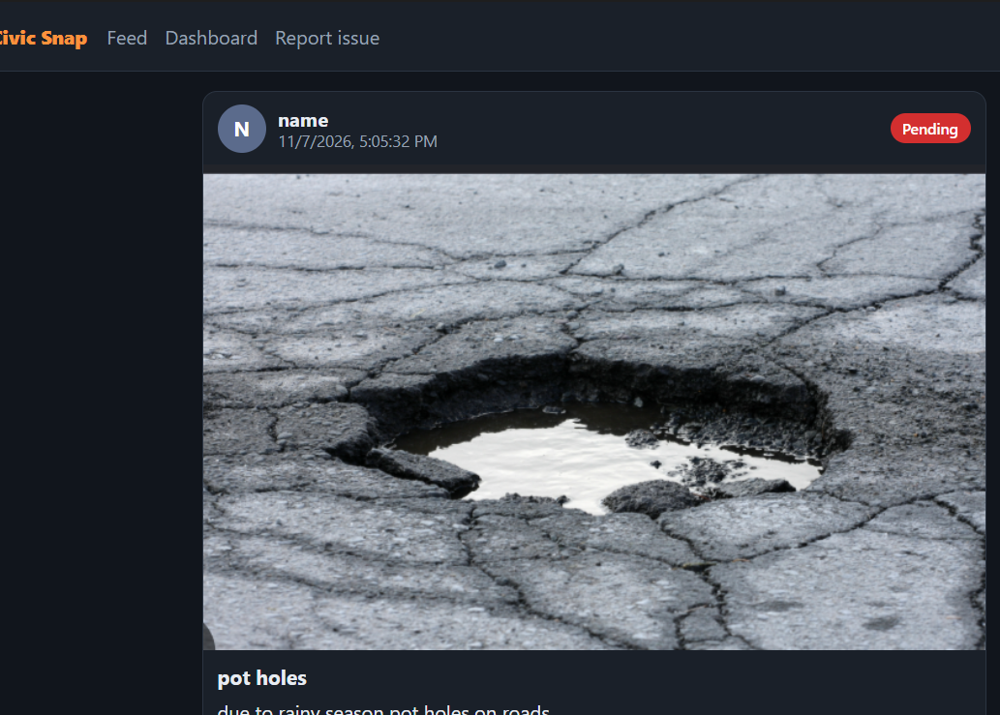
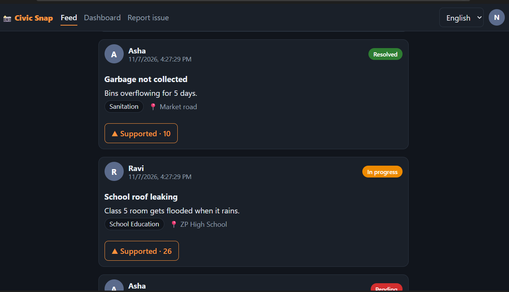
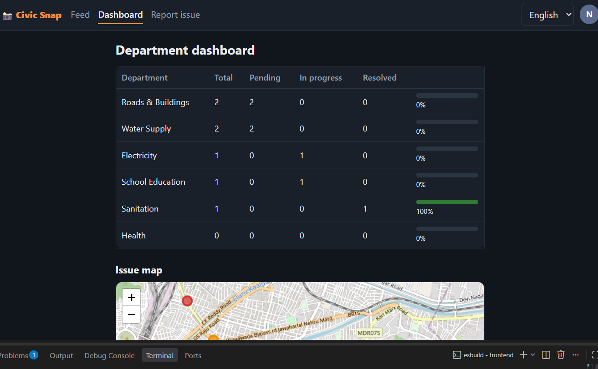

# Civic Snap

**A civic grievance reporting platform that connects citizens, department officers and the District Collector on one transparent, location-aware system.**

Citizens report problems such as damaged roads, water outages, power failures and school building issues with a photo or video and a GPS pin. Each report is routed to the responsible department, tracked to resolution, and made visible on a public dashboard.

**Stack:** Java 17 · Spring Boot 3 · Spring Security (JWT) · JPA/Hibernate · React 18 · Vite · Leaflet + OpenStreetMap

---

## Table of Contents

1. [Problem Statement](#problem-statement)
2. [Solution](#solution)
3. [Key Features](#key-features)
4. [User Roles](#user-roles)
5. [Screenshots](#screenshots)
6. [Architecture and Technology](#architecture-and-technology)
7. [How Duplicate Detection Works](#how-duplicate-detection-works)
8. [Getting Started](#getting-started)
9. [Demo Accounts](#demo-accounts)
10. [API Overview](#api-overview)
11. [Security](#security)
12. [Current Limitations](#current-limitations)
13. [Future Scope](#future-scope)

---

## Problem Statement

Citizens face everyday problems with public infrastructure: potholes, broken streetlights, missing water supply, overflowing garbage, leaking school roofs. Reporting them today is inefficient for everyone involved:

- **Reporting is fragmented.** People phone offices, post videos on social media or visit in person. There is no single place for a complaint, and no proof that it reached the right department.
- **No accountability.** Citizens cannot see whether an issue is pending, in progress or fixed. Departments are not measured on resolution rates.
- **Duplicate effort.** The same pothole is reported dozens of times in different places, which hides the real priority and wastes officers' time.
- **No overview for decision makers.** The District Collector has no consolidated view of how many issues each department has received and resolved.

## Solution

Civic Snap provides one platform where:

1. A citizen signs in, picks a department, describes the problem, attaches a photo or video, and marks the exact location on a map.
2. The report is tagged to that department and appears in a public feed, similar to a social media post. Other citizens can support the report instead of creating a duplicate.
3. The responsible officer updates the status (Pending, In progress, Resolved). Only that department's officer, or the Collector, can change it.
4. A public dashboard, visible without login, shows each department's total, pending, in-progress and resolved counts, a resolution percentage, and a map of all issues.
5. Every user, including officers and the Collector, has a profile page showing their activity.

## Key Features

- **Report with evidence and location:** photo or video upload, GPS button, and tap-to-pin map selection.
- **Department tagging:** each issue is assigned to one department (Roads & Buildings, Water Supply, Electricity, School Education, Sanitation, Health).
- **Social-style feed:** filter by department and status, support (upvote) issues, open an issue's detail page with its map location.
- **Duplicate detection:** warns the reporter if a similar unresolved issue already exists nearby, and offers to support it instead.
- **Public dashboard:** per-department counts, resolution progress bars, and a colour-coded issue map. No login required.
- **Role-based status updates:** enforced on the server, not only in the interface.
- **Profiles for every role:** avatar, bio, post count, resolved count, and a post grid. The Collector's profile also embeds the all-department dashboard.
- **Multilingual interface:** English, Telugu and Hindi, switchable at any time.

## User Roles

| Role | Capabilities | Profile shows |
|---|---|---|
| **Citizen** | Sign up, report issues, support issues, edit own profile | Posts and how many of them are resolved |
| **Officer** | Update the status of issues belonging to their own department | Department, posts, number of issues they resolved |
| **Collector** | Update the status of issues in any department | Posts, issues resolved, and the all-department dashboard |
| **Public (no login)** | View the feed, dashboard, map and profiles | |

Public sign-up always creates a Citizen. Officer and Collector accounts are created by the administrator through the seed data (`DataSeeder.java`), so no one can self-assign an elevated role.

## Screenshots






## Architecture and Technology

```
React (Vite) single-page app  ──  REST/JSON + JWT  ──  Spring Boot API  ──  JPA  ──  H2 / PostgreSQL
        │                                                    │
   Leaflet + OpenStreetMap                       Uploads stored on disk (/uploads)
```

| Layer | Technology |
|---|---|
| Frontend | React 18, React Router, Vite, Leaflet, custom i18n (English, Telugu, Hindi) |
| Backend | Java 17, Spring Boot 3.2, Spring Web, Spring Data JPA, Spring Security |
| Authentication | JSON Web Tokens (jjwt), BCrypt password hashing |
| Database | H2 file database by default, PostgreSQL supported through configuration |
| Maps | Leaflet with OpenStreetMap tiles (free, no API key) |

```
civic-snap/
├── backend/    Spring Boot API (model, repo, security, web)
└── frontend/   React app (pages, components, i18n, api client)
```

## How Duplicate Detection Works

When the reporter selects a department and a location, the client asks `GET /api/issues/nearby`. The server returns issues that are:

- in the **same department**,
- **not yet resolved**,
- created in the **last 30 days**, and
- within **100 metres** of the selected point.

The query first narrows candidates with a latitude/longitude bounding box in the database, then applies the exact haversine distance in code. If matches exist, the reporter sees them and can support an existing issue instead of posting a new one.

## Getting Started

### Prerequisites

- JDK 17 or later
- Maven 3.8 or later
- Node.js 18 or later

### 1. Run the backend

```bash
cd backend
mvn spring-boot:run
```

The API starts on `http://localhost:8080`. On first start it creates the departments, demo accounts and sample issues. Data is stored in `backend/data/`.

### 2. Run the frontend

```bash
cd frontend
npm install
npm run dev
```

Open `http://localhost:5173`. In development, Vite proxies `/api` and `/uploads` to the backend, so no CORS setup is needed.

### Configuration

Settings are in `backend/src/main/resources/application.properties`.

| Setting | Purpose |
|---|---|
| `JWT_SECRET` (environment variable) | Signing key for tokens. Set a strong value of at least 32 characters outside development. |
| `spring.datasource.*` | Switch from H2 to PostgreSQL (example included as comments in the file). |
| `app.upload-dir` | Folder for uploaded photos and videos. |
| `app.cors.origin` | Allowed frontend origin if you serve the frontend separately. |

To reset all data, stop the backend and delete the `backend/data` folder.

## Demo Accounts

All demo accounts use the password `demo123`. They exist for local development only and must be changed or removed before any real deployment.

| Role | Email |
|---|---|
| Collector | `collector@civic.in` |
| Officer (per department) | `roads@civic.in`, `water@civic.in`, `electricity@civic.in`, `schools@civic.in`, `sanitation@civic.in`, `health@civic.in` |
| Citizen | `asha@example.com`, `ravi@example.com` |

## API Overview

| Method | Endpoint | Access | Description |
|---|---|---|---|
| POST | `/api/auth/register` | Public | Create a citizen account |
| POST | `/api/auth/login` | Public | Log in and receive a JWT |
| GET | `/api/me` | Authenticated | Current user |
| GET | `/api/departments` | Public | List departments |
| GET | `/api/dashboard` | Public | Per-department counts |
| GET | `/api/issues` | Public | Feed, filter by `departmentId` and `status` |
| GET | `/api/issues/{id}` | Public | Issue details |
| GET | `/api/issues/nearby` | Public | Duplicate candidates for a department and location |
| POST | `/api/issues` | Authenticated | Create an issue (multipart, optional media file) |
| POST | `/api/issues/{id}/upvote` | Authenticated | Toggle support on an issue |
| PATCH | `/api/issues/{id}/status` | Officer of that department, or Collector | Update status |
| GET | `/api/users/{id}` | Public | Profile with posts |
| PUT | `/api/users/me` | Authenticated | Update own name and bio |

## Security

- Passwords are hashed with BCrypt; authentication uses signed, expiring JWTs.
- Authorization is enforced on the server: status changes are checked against the user's role and department.
- Public sign-up can only create Citizen accounts.
- Uploads are restricted to JPEG, PNG, WebP, MP4 and WebM, limited in size, and stored under random file names so user-supplied names are never used on disk.
- Map popups escape user-provided text to prevent script injection.
- A user can support an issue only once, enforced by a database unique constraint.

## Current Limitations

- No automated test suite yet.
- Uploaded files are stored on local disk, which does not suit multi-server deployments.
- The address is typed manually; it is not filled in automatically from the map pin.
- No email verification, password reset or rate limiting.
- Officers must open the app to see new issues; there are no notifications yet.
- Map tiles require an internet connection.

## Future Scope

**Intelligence**
- **AI summaries:** an assistant that summarizes each department's recent issues for officers, and a district-wide briefing for the Collector (top problems, hotspot areas, trends). The summary endpoint will work on aggregated issue data.
- **Automatic categorization:** suggest the right department from the uploaded photo and description.

**Workflow and accountability**
- Notifications to officers and citizens by email, SMS or WhatsApp when an issue is created or its status changes.
- Service-level timers with automatic escalation to the Collector for issues unresolved beyond a deadline.
- Resolution proof: officers attach an "after" photo when closing an issue, and citizens can confirm or reopen.
- Comments on issues and a visible status history.

**Platform and quality**
- PostgreSQL by default, cloud object storage for media, Docker packaging and a CI pipeline.
- Automated unit and integration tests.
- Public deployment with a live demo.
- Automatic address lookup from the map pin (reverse geocoding).

**Reach and experience**
- Installable mobile app or PWA with offline drafts and background upload.
- Additional regional languages and accessibility improvements.
- Heat maps and trend charts for the dashboard.
- Moderation tools, spam control and rate limiting.
